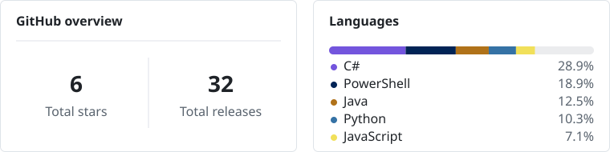

<!-- markdownlint-disable MD013 MD033 MD041 -->

  <picture>
    <source media="(max-width: 600px)" srcset="./assets/profile/header/mobile.svg">
    
  </picture>

## Building now

<!-- building_now:start -->
- [**MoreBookmarks-Vanillafied**](https://github.com/Yusseter/MoreBookmarks-Vanillafied) — Version of More Bookmarks+ adapted to Crusader Kings III's vanilla map projection. 
  <blockquote>Updated <relative-time datetime="2026-11-23T23:31:46Z">Nov 23, 2026</relative-time> · <a href="https://github.com/Yusseter?tab=repositories&amp;language=python"><picture><source media="(prefers-color-scheme: light) and (max-width: 600px)" srcset="./assets/profile/generated/languages/light/mobile/python.svg"><source media="(prefers-color-scheme: dark) and (max-width: 600px)" srcset="./assets/profile/generated/languages/dark/mobile/python.svg"><source media="(prefers-color-scheme: light)" srcset="./assets/profile/generated/languages/light/desktop/python.svg"><source media="(prefers-color-scheme: dark)" srcset="./assets/profile/generated/languages/dark/desktop/python.svg"></picture>Python</a></blockquote>
- [**Yusseters-Better-Map-Graphics**](https://github.com/Yusseter/Yusseters-Better-Map-Graphics) — A visual overhaul for Crusader Kings III that improves map clarity and aesthetics with cleaner terrain textures, improved borders, reduced water reflections, and a refined paper map. 
  <blockquote>Updated <relative-time datetime="2026-11-19T18:41:59Z">Nov 19, 2026</relative-time> · <a href="https://github.com/Yusseter?tab=repositories&amp;language=powershell"><picture><source media="(prefers-color-scheme: light) and (max-width: 600px)" srcset="./assets/profile/generated/languages/light/mobile/powershell.svg"><source media="(prefers-color-scheme: dark) and (max-width: 600px)" srcset="./assets/profile/generated/languages/dark/mobile/powershell.svg"><source media="(prefers-color-scheme: light)" srcset="./assets/profile/generated/languages/light/desktop/powershell.svg"><source media="(prefers-color-scheme: dark)" srcset="./assets/profile/generated/languages/dark/desktop/powershell.svg"></picture>PowerShell</a></blockquote>
<!-- building_now:end -->

## Recent commits

<!-- recent_commits:start -->
- [**MoreBookmarks-Vanillafied**](https://github.com/Yusseter/MoreBookmarks-Vanillafied) — [Merge upstream d3f1ce152 with western map additions](https://github.com/Yusseter/MoreBookmarks-Vanillafied/commit/a6f7d311d50e769efe40f07ed09dc17ed7c09edc) 
  <blockquote>Committed <relative-time datetime="2026-11-23T23:31:46Z">Nov 23, 2026</relative-time> · [&nbsp;a6f7d31](https://github.com/Yusseter/MoreBookmarks-Vanillafied/commit/a6f7d311d50e769efe40f07ed09dc17ed7c09edc)</blockquote>
- [**MoreBookmarks-Vanillafied**](https://github.com/Yusseter/MoreBookmarks-Vanillafied) — [Merge upstream compatibility and government history updates](https://github.com/Yusseter/MoreBookmarks-Vanillafied/commit/9680f752021a9e8d5c5d118916aacc54dfab4062) 
  <blockquote>Committed <relative-time datetime="2026-11-21T10:47:13Z">Nov 21, 2026</relative-time> · [&nbsp;9680f75](https://github.com/Yusseter/MoreBookmarks-Vanillafied/commit/9680f752021a9e8d5c5d118916aacc54dfab4062)</blockquote>
- [**MoreBookmarks-Vanillafied**](https://github.com/Yusseter/MoreBookmarks-Vanillafied) — [Merge upstream 1.21 trade and history updates](https://github.com/Yusseter/MoreBookmarks-Vanillafied/commit/e35aa5cfa01fbaf38a2c48257c67327931336b84) 
  <blockquote>Committed <relative-time datetime="2026-11-20T17:53:25Z">Nov 20, 2026</relative-time> · [&nbsp;e35aa5c](https://github.com/Yusseter/MoreBookmarks-Vanillafied/commit/e35aa5cfa01fbaf38a2c48257c67327931336b84)</blockquote>
- [**Yusseters-Better-Map-Graphics**](https://github.com/Yusseter/Yusseters-Better-Map-Graphics) — [Refine water rendering and regional map colors](https://github.com/Yusseter/Yusseters-Better-Map-Graphics/commit/b049f156a03a41310152a665e2de15592dd0920a) 
  <blockquote>Committed <relative-time datetime="2026-11-19T18:41:59Z">Nov 19, 2026</relative-time> · [&nbsp;b049f15](https://github.com/Yusseter/Yusseters-Better-Map-Graphics/commit/b049f156a03a41310152a665e2de15592dd0920a)</blockquote>
- [**Yusseters-Better-Map-Graphics**](https://github.com/Yusseter/Yusseters-Better-Map-Graphics) — [Remove redundant and outdated map overrides](https://github.com/Yusseter/Yusseters-Better-Map-Graphics/commit/5558f514cfc141702f66d3032f9afb077273f158) 
  <blockquote>Committed <relative-time datetime="2026-11-19T18:41:22Z">Nov 19, 2026</relative-time> · [&nbsp;5558f51](https://github.com/Yusseter/Yusseters-Better-Map-Graphics/commit/5558f514cfc141702f66d3032f9afb077273f158)</blockquote>
<!-- recent_commits:end -->

## Recent releases

<!-- recent_releases:start -->
- [**Yusseter's Better Map Graphics 1.2.4**&nbsp;](https://github.com/Yusseter/Yusseters-Better-Map-Graphics/releases/tag/v1.2.4) 
  <blockquote>Released <relative-time datetime="2026-11-18T21:34:58Z">Nov 18, 2026</relative-time> · [&nbsp;v1.2.4](https://github.com/Yusseter/Yusseters-Better-Map-Graphics/tree/v1.2.4)</blockquote>
- [**CK3 Syntax 0.0.4**&nbsp;](https://github.com/Yusseter/ck3-syntax/releases/tag/v0.0.4) 
  <blockquote>Released <relative-time datetime="2026-10-30T13:17:42Z">Oct 30, 2026</relative-time> · [&nbsp;v0.0.4](https://github.com/Yusseter/ck3-syntax/tree/v0.0.4)</blockquote>
- [**Yusseter's Better Map Graphics 1.2.3**](https://github.com/Yusseter/Yusseters-Better-Map-Graphics/releases/tag/v1.2.3) 
  <blockquote>Released <relative-time datetime="2026-09-30T23:05:36Z">Sep 30, 2026</relative-time> · [&nbsp;v1.2.3](https://github.com/Yusseter/Yusseters-Better-Map-Graphics/tree/v1.2.3)</blockquote>

More releases

- [**Tray Order Lock 0.2.0**&nbsp;](https://github.com/Yusseter/tray-order-lock/releases/tag/v0.2.0) 
  <blockquote>Released <relative-time datetime="2026-08-28T11:31:20Z">Aug 28, 2026</relative-time> · [&nbsp;v0.2.0](https://github.com/Yusseter/tray-order-lock/tree/v0.2.0)</blockquote>
- [**test**&nbsp;](https://github.com/Yusseter/Minecraft-Yusseter-s-Vanilla-Resource-Pack/releases/tag/test) 
  <blockquote>Released <relative-time datetime="2026-08-20T14:03:25Z">Aug 20, 2026</relative-time> · [&nbsp;test](https://github.com/Yusseter/Minecraft-Yusseter-s-Vanilla-Resource-Pack/tree/test)</blockquote>
- [**CK3 Workshop Auto Updater 0.3.1**&nbsp;](https://github.com/Yusseter/ck3-workshop-auto-updater/releases/tag/v0.3.1) 
  <blockquote>Released <relative-time datetime="2026-08-19T15:55:31Z">Aug 19, 2026</relative-time> · [&nbsp;v0.3.1](https://github.com/Yusseter/ck3-workshop-auto-updater/tree/v0.3.1)</blockquote>
- [**CK3 Workshop Auto Updater 0.3.0**](https://github.com/Yusseter/ck3-workshop-auto-updater/releases/tag/v0.3.0) 
  <blockquote>Released <relative-time datetime="2026-08-07T09:23:12Z">Aug 7, 2026</relative-time> · [&nbsp;v0.3.0](https://github.com/Yusseter/ck3-workshop-auto-updater/tree/v0.3.0)</blockquote>
- [**Tray Order Lock 0.1.0**](https://github.com/Yusseter/tray-order-lock/releases/tag/v0.1.0) 
  <blockquote>Released <relative-time datetime="2026-08-05T19:40:24Z">Aug 5, 2026</relative-time> · [&nbsp;v0.1.0](https://github.com/Yusseter/tray-order-lock/tree/v0.1.0)</blockquote>

<!-- recent_releases:end -->

## GitHub snapshot

<!-- snapshot:start -->

  <picture>
    <source media="(max-width: 600px)" srcset="./assets/profile/generated/snapshot/mobile.svg">
    
  </picture>

<!-- snapshot:end -->
