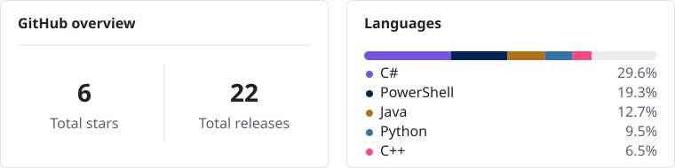

<!-- markdownlint-disable MD013 MD033 MD041 -->

  <picture>
    <source media="(max-width: 600px)" srcset="./assets/profile/header/mobile.svg">
    
  </picture>

## Building now

<!-- building_now:start -->
- [**MoreBookmarks-Vanillafied**](https://github.com/Yusseter/MoreBookmarks-Vanillafied) — Version of More Bookmarks+ adapted to Crusader Kings III's vanilla map projection. 
  <blockquote>Updated <relative-time datetime="2026-10-19T18:32:21Z">Oct 19, 2026</relative-time> · <a href="https://github.com/Yusseter?tab=repositories&amp;language=python"><picture><source media="(prefers-color-scheme: light) and (max-width: 600px)" srcset="./assets/profile/generated/languages/light/mobile/python.svg"><source media="(prefers-color-scheme: dark) and (max-width: 600px)" srcset="./assets/profile/generated/languages/dark/mobile/python.svg"><source media="(prefers-color-scheme: light)" srcset="./assets/profile/generated/languages/light/desktop/python.svg"><source media="(prefers-color-scheme: dark)" srcset="./assets/profile/generated/languages/dark/desktop/python.svg"></picture>Python</a></blockquote>
<!-- building_now:end -->

## Recent commits

<!-- recent_commits:start -->
- [**MoreBookmarks-Vanillafied**](https://github.com/Yusseter/MoreBookmarks-Vanillafied) — [Integrate upstream religion and history updates](https://github.com/Yusseter/MoreBookmarks-Vanillafied/commit/7aca7efa209fc2fe59fe4f604e4c206066cd7af4) 
  <blockquote>Committed <relative-time datetime="2026-10-19T18:32:21Z">Oct 19, 2026</relative-time> · [&nbsp;7aca7ef](https://github.com/Yusseter/MoreBookmarks-Vanillafied/commit/7aca7efa209fc2fe59fe4f604e4c206066cd7af4)</blockquote>
- [**MoreBookmarks-Vanillafied**](https://github.com/Yusseter/MoreBookmarks-Vanillafied) — [Track coat of arms assets and remove obsolete exclusions](https://github.com/Yusseter/MoreBookmarks-Vanillafied/commit/06587d6225ce88802b507127e9965a8be3159e4e) 
  <blockquote>Committed <relative-time datetime="2026-10-18T15:08:19Z">Oct 18, 2026</relative-time> · [&nbsp;06587d6](https://github.com/Yusseter/MoreBookmarks-Vanillafied/commit/06587d6225ce88802b507127e9965a8be3159e4e)</blockquote>
- [**MoreBookmarks-Vanillafied**](https://github.com/Yusseter/MoreBookmarks-Vanillafied) — [Refine text attributes and ignore rules](https://github.com/Yusseter/MoreBookmarks-Vanillafied/commit/221367ce455ef13bdc54d2859dc3a38a17636b4f) 
  <blockquote>Committed <relative-time datetime="2026-10-18T15:00:21Z">Oct 18, 2026</relative-time> · [&nbsp;221367c](https://github.com/Yusseter/MoreBookmarks-Vanillafied/commit/221367ce455ef13bdc54d2859dc3a38a17636b4f)</blockquote>
- [**MoreBookmarks-Vanillafied**](https://github.com/Yusseter/MoreBookmarks-Vanillafied) — [Add project README](https://github.com/Yusseter/MoreBookmarks-Vanillafied/commit/fb32042c71290198a0c386d6c63bb96df9f73da3) 
  <blockquote>Committed <relative-time datetime="2026-10-18T13:32:50Z">Oct 18, 2026</relative-time> · [&nbsp;fb32042](https://github.com/Yusseter/MoreBookmarks-Vanillafied/commit/fb32042c71290198a0c386d6c63bb96df9f73da3)</blockquote>
- [**MoreBookmarks-Vanillafied**](https://github.com/Yusseter/MoreBookmarks-Vanillafied) — [Merge upstream character and ecclesiastical history updates](https://github.com/Yusseter/MoreBookmarks-Vanillafied/commit/b094605d6ded4716c83d0c9d6145b82d862b8c9f) 
  <blockquote>Committed <relative-time datetime="2026-10-17T17:59:52Z">Oct 17, 2026</relative-time> · [&nbsp;b094605](https://github.com/Yusseter/MoreBookmarks-Vanillafied/commit/b094605d6ded4716c83d0c9d6145b82d862b8c9f)</blockquote>
<!-- recent_commits:end -->

## Recent releases

<!-- recent_releases:start -->
- [**Yusseter's Better Map Graphics 1.2.3**&nbsp;](https://github.com/Yusseter/Yusseters-Better-Map-Graphics/releases/tag/v1.2.3) 
  <blockquote>Released <relative-time datetime="2026-09-30T23:05:36Z">Sep 30, 2026</relative-time> · [&nbsp;v1.2.3](https://github.com/Yusseter/Yusseters-Better-Map-Graphics/tree/v1.2.3)</blockquote>
- [**Tray Order Lock 0.2.0**&nbsp;](https://github.com/Yusseter/tray-order-lock/releases/tag/v0.2.0) 
  <blockquote>Released <relative-time datetime="2026-08-28T11:31:20Z">Aug 28, 2026</relative-time> · [&nbsp;v0.2.0](https://github.com/Yusseter/tray-order-lock/tree/v0.2.0)</blockquote>
- [**test**&nbsp;](https://github.com/Yusseter/Minecraft-Yusseter-s-Vanilla-Resource-Pack/releases/tag/test) 
  <blockquote>Released <relative-time datetime="2026-08-20T14:03:25Z">Aug 20, 2026</relative-time> · [&nbsp;test](https://github.com/Yusseter/Minecraft-Yusseter-s-Vanilla-Resource-Pack/tree/test)</blockquote>

More releases

- [**CK3 Workshop Auto Updater 0.3.1**&nbsp;](https://github.com/Yusseter/ck3-workshop-auto-updater/releases/tag/v0.3.1) 
  <blockquote>Released <relative-time datetime="2026-08-19T15:55:31Z">Aug 19, 2026</relative-time> · [&nbsp;v0.3.1](https://github.com/Yusseter/ck3-workshop-auto-updater/tree/v0.3.1)</blockquote>
- [**CK3 Workshop Auto Updater 0.3.0**](https://github.com/Yusseter/ck3-workshop-auto-updater/releases/tag/v0.3.0) 
  <blockquote>Released <relative-time datetime="2026-08-07T09:23:12Z">Aug 7, 2026</relative-time> · [&nbsp;v0.3.0](https://github.com/Yusseter/ck3-workshop-auto-updater/tree/v0.3.0)</blockquote>
- [**Tray Order Lock 0.1.0**](https://github.com/Yusseter/tray-order-lock/releases/tag/v0.1.0) 
  <blockquote>Released <relative-time datetime="2026-08-05T19:40:24Z">Aug 5, 2026</relative-time> · [&nbsp;v0.1.0](https://github.com/Yusseter/tray-order-lock/tree/v0.1.0)</blockquote>
- [**CK3 Workshop Auto Updater 0.2.0**&nbsp;](https://github.com/Yusseter/ck3-workshop-auto-updater/releases/tag/v0.2.0) 
  <blockquote>Released <relative-time datetime="2026-08-05T11:08:17Z">Aug 5, 2026</relative-time> · [&nbsp;v0.2.0](https://github.com/Yusseter/ck3-workshop-auto-updater/tree/v0.2.0)</blockquote>
- [**CK3 Workshop Auto Updater 0.1.1**&nbsp;](https://github.com/Yusseter/ck3-workshop-auto-updater/releases/tag/v0.1.1) 
  <blockquote>Released <relative-time datetime="2026-08-05T10:06:18Z">Aug 5, 2026</relative-time> · [&nbsp;v0.1.1](https://github.com/Yusseter/ck3-workshop-auto-updater/tree/v0.1.1)</blockquote>

<!-- recent_releases:end -->

## GitHub snapshot

<!-- snapshot:start -->

  <picture>
    <source media="(max-width: 600px)" srcset="./assets/profile/generated/snapshot/mobile.svg">
    
  </picture>

<!-- snapshot:end -->
