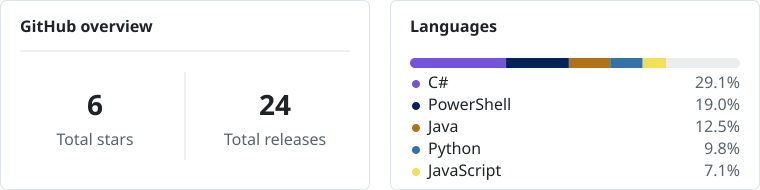

<!-- markdownlint-disable MD013 MD033 MD041 -->

  <picture>
    <source media="(max-width: 600px)" srcset="./assets/profile/header/mobile.svg">
    
  </picture>

## Building now

<!-- building_now:start -->
- [**MoreBookmarks-Vanillafied**](https://github.com/Yusseter/MoreBookmarks-Vanillafied) — Version of More Bookmarks+ adapted to Crusader Kings III's vanilla map projection. 
  <blockquote>Updated <relative-time datetime="2026-11-05T06:43:18Z">Nov 5, 2026</relative-time> · <a href="https://github.com/Yusseter?tab=repositories&amp;language=python"><picture><source media="(prefers-color-scheme: light) and (max-width: 600px)" srcset="./assets/profile/generated/languages/light/mobile/python.svg"><source media="(prefers-color-scheme: dark) and (max-width: 600px)" srcset="./assets/profile/generated/languages/dark/mobile/python.svg"><source media="(prefers-color-scheme: light)" srcset="./assets/profile/generated/languages/light/desktop/python.svg"><source media="(prefers-color-scheme: dark)" srcset="./assets/profile/generated/languages/dark/desktop/python.svg"></picture>Python</a></blockquote>
- [**ck3-syntax**](https://github.com/Yusseter/ck3-syntax) — Crusader Kings III syntax highlighting, localization support and script formatting for Visual Studio Code. 
  <blockquote>Updated <relative-time datetime="2026-10-30T13:35:43Z">Oct 30, 2026</relative-time> · <a href="https://github.com/Yusseter?tab=repositories&amp;language=javascript"><picture><source media="(prefers-color-scheme: light) and (max-width: 600px)" srcset="./assets/profile/generated/languages/light/mobile/javascript.svg"><source media="(prefers-color-scheme: dark) and (max-width: 600px)" srcset="./assets/profile/generated/languages/dark/mobile/javascript.svg"><source media="(prefers-color-scheme: light)" srcset="./assets/profile/generated/languages/light/desktop/javascript.svg"><source media="(prefers-color-scheme: dark)" srcset="./assets/profile/generated/languages/dark/desktop/javascript.svg"></picture>JavaScript</a></blockquote>
<!-- building_now:end -->

## Recent commits

<!-- recent_commits:start -->
- [**MoreBookmarks-Vanillafied**](https://github.com/Yusseter/MoreBookmarks-Vanillafied) — [Merge upstream monastic orders and history updates](https://github.com/Yusseter/MoreBookmarks-Vanillafied/commit/8c097c250bb46cd56f39f4e4e2e947616bb0ff1f) 
  <blockquote>Committed <relative-time datetime="2026-11-05T06:43:18Z">Nov 5, 2026</relative-time> · [&nbsp;8c097c2](https://github.com/Yusseter/MoreBookmarks-Vanillafied/commit/8c097c250bb46cd56f39f4e4e2e947616bb0ff1f)</blockquote>
- [**MoreBookmarks-Vanillafied**](https://github.com/Yusseter/MoreBookmarks-Vanillafied) — [Merge upstream religious orders and history updates](https://github.com/Yusseter/MoreBookmarks-Vanillafied/commit/fc319cd23c6d8cb973b441b44df607ab9920a564) 
  <blockquote>Committed <relative-time datetime="2026-11-03T22:42:36Z">Nov 3, 2026</relative-time> · [&nbsp;fc319cd](https://github.com/Yusseter/MoreBookmarks-Vanillafied/commit/fc319cd23c6d8cb973b441b44df607ab9920a564)</blockquote>
- [**MoreBookmarks-Vanillafied**](https://github.com/Yusseter/MoreBookmarks-Vanillafied) — [Merge upstream religion and holy-site updates](https://github.com/Yusseter/MoreBookmarks-Vanillafied/commit/70ce088fc59336b1f54aba9b1a6d862f40e84d50) 
  <blockquote>Committed <relative-time datetime="2026-11-01T21:18:30Z">Nov 1, 2026</relative-time> · [&nbsp;70ce088](https://github.com/Yusseter/MoreBookmarks-Vanillafied/commit/70ce088fc59336b1f54aba9b1a6d862f40e84d50)</blockquote>
- [**MoreBookmarks-Vanillafied**](https://github.com/Yusseter/MoreBookmarks-Vanillafied) — [Merge upstream Rite and monastic history updates](https://github.com/Yusseter/MoreBookmarks-Vanillafied/commit/ed4231caec83287898237a62d0e8c7989b0cf6f6) 
  <blockquote>Committed <relative-time datetime="2026-10-31T20:45:14Z">Oct 31, 2026</relative-time> · [&nbsp;ed4231c](https://github.com/Yusseter/MoreBookmarks-Vanillafied/commit/ed4231caec83287898237a62d0e8c7989b0cf6f6)</blockquote>
- [**ck3-syntax**](https://github.com/Yusseter/ck3-syntax) — [Archive complete release notes by tag](https://github.com/Yusseter/ck3-syntax/commit/c1d96d32907fea9f5f09060032749e93cd7f4314) 
  <blockquote>Committed <relative-time datetime="2026-10-30T13:35:43Z">Oct 30, 2026</relative-time> · [&nbsp;c1d96d3](https://github.com/Yusseter/ck3-syntax/commit/c1d96d32907fea9f5f09060032749e93cd7f4314)</blockquote>
<!-- recent_commits:end -->

## Recent releases

<!-- recent_releases:start -->
- [**CK3 Syntax 0.0.4**&nbsp;](https://github.com/Yusseter/ck3-syntax/releases/tag/v0.0.4) 
  <blockquote>Released <relative-time datetime="2026-10-30T13:17:42Z">Oct 30, 2026</relative-time> · [&nbsp;v0.0.4](https://github.com/Yusseter/ck3-syntax/tree/v0.0.4)</blockquote>
- [**Yusseter's Better Map Graphics 1.2.3**&nbsp;](https://github.com/Yusseter/Yusseters-Better-Map-Graphics/releases/tag/v1.2.3) 
  <blockquote>Released <relative-time datetime="2026-09-30T23:05:36Z">Sep 30, 2026</relative-time> · [&nbsp;v1.2.3](https://github.com/Yusseter/Yusseters-Better-Map-Graphics/tree/v1.2.3)</blockquote>
- [**Tray Order Lock 0.2.0**&nbsp;](https://github.com/Yusseter/tray-order-lock/releases/tag/v0.2.0) 
  <blockquote>Released <relative-time datetime="2026-08-28T11:31:20Z">Aug 28, 2026</relative-time> · [&nbsp;v0.2.0](https://github.com/Yusseter/tray-order-lock/tree/v0.2.0)</blockquote>

More releases

- [**test**&nbsp;](https://github.com/Yusseter/Minecraft-Yusseter-s-Vanilla-Resource-Pack/releases/tag/test) 
  <blockquote>Released <relative-time datetime="2026-08-20T14:03:25Z">Aug 20, 2026</relative-time> · [&nbsp;test](https://github.com/Yusseter/Minecraft-Yusseter-s-Vanilla-Resource-Pack/tree/test)</blockquote>
- [**CK3 Workshop Auto Updater 0.3.1**&nbsp;](https://github.com/Yusseter/ck3-workshop-auto-updater/releases/tag/v0.3.1) 
  <blockquote>Released <relative-time datetime="2026-08-19T15:55:31Z">Aug 19, 2026</relative-time> · [&nbsp;v0.3.1](https://github.com/Yusseter/ck3-workshop-auto-updater/tree/v0.3.1)</blockquote>
- [**CK3 Workshop Auto Updater 0.3.0**](https://github.com/Yusseter/ck3-workshop-auto-updater/releases/tag/v0.3.0) 
  <blockquote>Released <relative-time datetime="2026-08-07T09:23:12Z">Aug 7, 2026</relative-time> · [&nbsp;v0.3.0](https://github.com/Yusseter/ck3-workshop-auto-updater/tree/v0.3.0)</blockquote>
- [**Tray Order Lock 0.1.0**](https://github.com/Yusseter/tray-order-lock/releases/tag/v0.1.0) 
  <blockquote>Released <relative-time datetime="2026-08-05T19:40:24Z">Aug 5, 2026</relative-time> · [&nbsp;v0.1.0](https://github.com/Yusseter/tray-order-lock/tree/v0.1.0)</blockquote>
- [**CK3 Workshop Auto Updater 0.2.0**&nbsp;](https://github.com/Yusseter/ck3-workshop-auto-updater/releases/tag/v0.2.0) 
  <blockquote>Released <relative-time datetime="2026-08-05T11:08:17Z">Aug 5, 2026</relative-time> · [&nbsp;v0.2.0](https://github.com/Yusseter/ck3-workshop-auto-updater/tree/v0.2.0)</blockquote>

<!-- recent_releases:end -->

## GitHub snapshot

<!-- snapshot:start -->

  <picture>
    <source media="(max-width: 600px)" srcset="./assets/profile/generated/snapshot/mobile.svg">
    
  </picture>

<!-- snapshot:end -->
